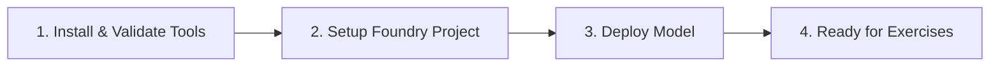

# Prerequisites and Environment Setup

Welcome to the **Build AI Agents with Microsoft Foundry & VS Code** workshop. Before starting the hands-on exercises, ensure your development environment is properly configured.

This guide covers all required tools, account permissions, local verification commands, project setup workflows, model deployment steps, and cleanup instructions.

---

## Summary Workflow



---

## Prerequisites Checklist

Verify that you have all necessary tools, access permissions, and runtimes installed before proceeding.

### Runtimes & Local Development Tools

| Tool / Runtime | Requirement | Purpose |
| :--- | :--- | :--- |
| **[Visual Studio Code](https://code.visualstudio.com/)** | Latest Version | Core IDE for agent development & extension support |
| **[Python 3.13](https://www.python.org/downloads/)** | 3.13.x (e.g., 3.13.12) | Runtime for Python-based agent frameworks |
| **[Node.js](https://nodejs.org/en/download/)** | v18.0 or later | Execution environment for CLI tools & integrations |
| **[Git](https://git-scm.com/downloads)** | Latest Version | Source control for cloning exercise templates |
| **[Azure CLI](https://learn.microsoft.com/cli/azure/install-azure-cli)** | Authenticated (`az login`) | Command-line management of Azure resources |

> **Important**: Python 3.14 is currently **not supported** as several key dependencies do not yet have 3.14 builds. This workshop has been tested with **Python 3.13.12**.

### Accounts & Licensing

- **[Azure Subscription](https://azure.microsoft.com/free/)**: Active subscription with permissions and quota to create Azure AI Foundry resources.
- **Microsoft 365 Account**: Required with Microsoft Teams access for M365 exercises.
- **Microsoft 365 Copilot License**: *(Optional)* Required for Copilot deployment exercises.
- **Work IQ Admin Approval**: Required for organizational accounts accessing Work IQ features.

---

## Validate Your Environment

Before creating Azure resources, verify your local tools using your terminal:

```bash
python --version
node --version
git --version
az --version
```

Then authenticate with the Azure CLI:

```bash
az login
```

Confirm that the expected Azure subscription is selected:

```bash
az account show
```

If you have access to multiple subscriptions, list them and set your target subscription:

```bash
az account list --output table
az account set --subscription <subscription-id>
```

> **Checkpoint**: Do not continue until VS Code, Python 3.13, Node.js 18+, Git, and Azure CLI are verified and `az login` succeeds.

---

## Setting Up Microsoft Foundry Projects

Every exercise in this workshop requires a Microsoft Foundry project. You can set up your project using either the **Foundry Portal** or the **VS Code Foundry Toolkit Extension**.

> **Project Naming Convention**: Always use the standardized format:
> `foundry-ex-{exercise-number}-{short-name}`
> 
> *Examples*: `foundry-ex-01-it-support`, `foundry-ex-02-custom-tools`, `foundry-ex-06-workflow`

---

<a id="portal-create-project"></a>
### Option A: Create a Foundry Project via Portal

Microsoft Foundry uses projects to organize models, resources, data, and assets for your AI solution.

1. **Access the Portal**: Open the [Foundry Portal](https://ai.azure.com) in your browser and sign in with your Azure credentials. Close any initial tips or quick start panes.
   
   > **Note**: Ensure you are using the **New** Microsoft Foundry experience. If prompted, select **Start building** in the top banner.

2. **Initiate Project Creation**: On the home page, select **Start building** > **Create new project** (or select **Create project**).

3. **Configure Project Details**:
   - **Project Name**: Enter a name matching the naming convention (e.g., `foundry-ex-01-it-support`).

4. **Configure Advanced Options**: Expand **Advanced options** and set:
   - **Microsoft Foundry Resource**: Enter a valid resource name (e.g., `foundry-resource-{region}`).
   - **Region**: Select a region close to you with available quota.
   - **Subscription**: Select your active Azure subscription.
   - **Resource Group**: Choose an existing resource group or create a new one.

   > **Region Quotas**: Azure AI resources are subject to regional model quotas. If you encounter quota limits, try selecting a different region for your resource.

5. **Deploy Project**: Select **Create** and wait for provision completion.

6. **Next Steps**: When provisioning completes, select **Next** on the welcome dialog and click **Create agent** (or select **Start building** > **Create agents** from the drop-down menu).

---

<a id="toolkit-create-project"></a>
### Option B: Create a Foundry Project via VS Code Toolkit

The **Foundry Toolkit for VS Code** extension enables complete project management within your code editor.

#### Step 1: Install the Extension

1. Open **Visual Studio Code**.
2. Open the Extensions view (`Ctrl+Shift+X` on Windows/Linux or `Cmd+Shift+X` on macOS).
3. Search for `Foundry Toolkit for VS Code` (published by Microsoft) and click **Install**.

> **Naming Note**: The extension is listed as **Foundry Toolkit**, but some VS Code labels, older commands, or screenshots may refer to **AI Toolkit**. Treat those names as referring to the same extension experience.

4. Select the **Foundry Toolkit** icon on the VS Code Activity Bar and sign in to your Azure account if prompted.

#### Step 2: Provision the Project

5. Under **Microsoft Foundry Resources**, select **Create Project**.
   - *If an active default project already exists*, right-click the active project under **My Resources** and select **Switch Default Project in Azure Extension** to create a new one.

6. Select your Azure subscription, resource group, and enter the project name following the naming convention (e.g., `foundry-ex-02-custom-tools`).

7. Once deployment finishes, your new project will appear in the Foundry Toolkit pane as the default project.

---

<a id="deploy-model"></a>
## Deploying a Model to Foundry

AI agents require a deployed generative model from the Microsoft Foundry Model Catalog. Depending on your lab exercise requirements or preference, you can choose from various model families:

- **OpenAI Models**: `gpt-5.5`, `gpt-5.2`, `gpt-5`, `gpt-4o` (Recommended for general agent reasoning, tools, and code interpreter)
- **Anthropic Claude Models**: `claude-sonnet-5`, `claude-haiku-4-5`, `claude-opus-5`(Ideal for complex reasoning, extended thinking, analysis, and natural dialogue)
- **Open-Weight Models**: `DeepSeek-R1`, `Llama-3.3-70B-Instruct`, `Mistral-Large-2411`, `Phi-4`, `Qwen3.5-35B` (Great for customized, open-architecture, and edge deployment scenarios)

### Steps to Deploy a Model

1. **Open Model Catalog**:
   - If creating via portal/extension popup: Click **Deploy a new model** when project creation completes.
   - *Alternative*: In VS Code, click the **+** icon next to **Models** under Resources, or press `F1` and run **Foundry Toolkit: Show model catalog**.

2. **Select Model**: Search for your chosen model family in the catalog (e.g., search `gpt-5.5`, `claude-sonnet-5`, or `DeepSeek-R1`).

3. **Initiate Deployment**: Click **Deploy** next to the target model.

4. **Configure Settings**:
   - **Deployment Name**: Specify a descriptive name matching your choice (e.g., `gpt-5-5`, `claude-sonnet-5`, `deepseek-r1`, or `llama-3-3-70b`).
   - **Deployment Type**: Select **Global Standard** (or **Standard** if Global Standard is unavailable for your region).
   - **Model Version**: Leave as default.
   - **Tokens Per Minute**: Leave as default.

5. **Complete Deployment**: Click **Deploy to Microsoft Foundry** in the bottom-left corner and wait for deployment to complete.

6. **Copy Project Endpoint**: Right-click your deployed model/project in the Resources view and select **Copy Project Endpoint**. Save this URL to connect your agent in subsequent steps.

---

## Next Steps

[**Next Exercise: 01 - Build AI Agents with Portal and VS Code**](01-build-agent-portal-and-vscode.md)

